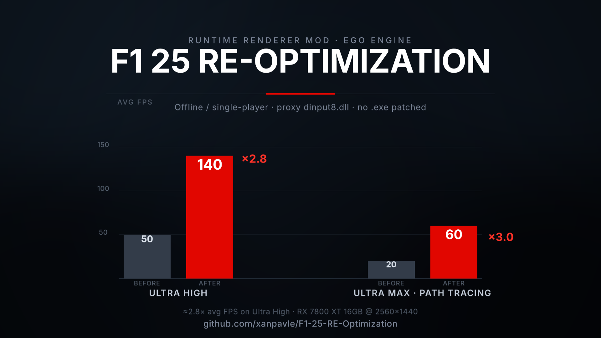

# F1 25 RE-Optimization

A runtime renderer optimisation for **F1 25** (EGO engine, Codemasters / EA), built
by reverse-engineering the shipped executable. It makes the renderer do **less work
for the same look** — no `F1_25.exe` bytes are patched on disk.

**v0.3.0** · [FAQ](docs/faq.md) · [Troubleshooting](docs/troubleshooting.md) · [Engineering notes](docs/engineering.md) · [Changelog](CHANGELOG.md)

Built and tested on a single machine, offline, single-player.



---

## ⚠️ Disclaimer — read this before you do anything

- **Unofficial.** Not affiliated with, endorsed by, or supported by EA, Codemasters,
  or any of their partners. "F1" and "F1 25" are trademarks of their owners.
- **OFFLINE / SINGLE-PLAYER ONLY.** This is a runtime DLL. It does **not** bypass,
  disable, or evade anti-cheat, and it is **not** intended for online play. Playing
  online with it present may get you banned. Remove it before going online.
- **Use at your own risk.** No warranty of any kind. You are responsible for your own
  machine, your own game install, and your own account.
- **It edits your graphics settings file** (`hardware_settings_config.xml`) at launch and
  enforces the tuned values inside the running engine. An untouched backup (`.untuned`)
  is kept so you can revert.
- Reverse engineering was performed on the author's own legally-owned copy of the game,
  for personal optimisation and educational purposes only. No game assets or code are
  redistributed here.
- **No results are guaranteed.** Benchmarks below are from one machine; your mileage
  will vary.

---

## Results (measured on the reference machine)

Reference system:

| | |
|---|---|
| GPU | AMD Radeon RX 7800 XT (16 GB) |
| CPU | AMD Ryzen 5 7600X |
| RAM | 32 GB |
| Display | 2560×1440 @ 165 Hz, Windows 10 |
| In-game | FSR 3 Quality, Frame Generation ON, Ray Tracing ON |

Benchmark: **F1 25 built-in benchmark, Austria, wet, 20 cars, 1 lap, cycle cam**, run
from the game's own `-benchmark <file>` mode so the two runs are identical apart from
the mod. **avg FPS is the on-screen number** (Frame Gen on); median and 1% low are
frame-time (rendered) figures:

| Run | avg FPS | median | 1% low |
|---|---|---|---|
| Stock Ultra High, all RT on, TAA only | 97 | 48.1 | 39.3 |
| **v0.2.5** (FSR 3 auto + tuned delta + `rt_ao`/`rt_ddgi` off) | **177** | **88.5** | **72.0** |

On-screen (Frame Gen on) that's **97 -> 177 FPS (+82%)**; the frame-time (rendered)
figure is 46.4 -> 81.5 (+76%). Most of it comes from the upscaler finally engaging (a
prerequisite fix in v0.2.5 — the engine was silently falling back to TAA); the tuned
raster/RT delta adds the rest. Numbers are from a single machine and will vary.

> **Still Image Quality first?** The default that produced the table above is
> `enforce_mode = cheaper` (only ever removes work) with `[upscaler] mode=auto`. To
> keep the exact Ultra High look and give up the upscaler, set `mode = keep` or
> `mode = taa` in `f125_tune.ini`.
>
> The displayed benchmark numbers include **Frame Generation**; compare like-for-like
> with `benchmark\Benchmark_*.xml` on your own machine.

---

## What changed in v0.3.0

**Three presets, an installer menu, and an A/B switch.** The headline numbers
above are unchanged (they are the Balanced preset).

- **Presets.** The installer now asks which one you want:

  ```
  Choose a preset:
    1) Quality   (for Ultra Max / Ultra High)  - keeps RT AO, DDGI, grass, sharp shadows
    2) Balanced  (for High / Medium)           - the original tuning, same look, more FPS
    3) Potato    (for Low / Ultra Low)          - lowest settings, ray tracing off, max FPS
    4) Recommended for your PC                  - picked from your graphics card
  ```

  | Preset | What it does |
  |---|---|
  | **Quality** | Balanced, but ray-traced AO and DDGI, grass, hair, 4096 shadows, full SSAO/SSRT and sharper fog stay on. |
  | **Balanced** | The original tuning from 0.2.x. Same look, much less work. |
  | **Potato** | Everything that costs real GPU time is cut, ray tracing included: shadows 1024, fog 256×128, no SSAO/SSRT/DOF, low crowd and particles, no grass. Mirrors are never touched. |

  "Recommended" uses your graphics card: RTX 4080/4090/5070 Ti and up and RX 7900 /
  9070 → Quality; GTX, RX 400–5000, RX 6400/6500 and integrated graphics → Potato;
  everything else → Balanced. Change it later by running the installer again or by
  editing `preset =` in `f125_tune.ini`. The launch banner shows the active preset.
- **A/B switch: Ctrl+F10.** In game, Ctrl+F10 switches between **stock** and
  **mod** settings for the **next launch**. Most of the mod's effect is loaded once at
  startup, so it can't switch mid-race. A stock launch puts your untouched original
  settings back (`.untuned`) and installs no hooks; the banner says
  *A/B: running STOCK*. Press Ctrl+F10 again to go back to the mod.

## What changed in v0.2.9

A safety release. The look and the tuning are unchanged from 0.2.8.

- **Game-update check.** At launch the mod reads the `F1_25.exe` header (timestamp
  `6AA3C898`, image size `193E6000`) and logs whether it is the build it was made for,
  **1.0.141.7865**. On any other build it trusts **no** hard-coded address: every hook is
  re-derived by signature, and any hook that does not verify is skipped and logged. If
  you would rather have the mod switch itself off after a game patch, set
  `unknown_build = off` in `[profile]`. The game then runs completely stock.
- **Safer hooks.** Before copying a function's first bytes into a trampoline, the hook
  engine now decodes them. It refuses to patch if the length would cut an instruction
  in half, or if those bytes contain a branch or a RIP-relative operand. Before, it
  copied them blindly.
- **Launch banner.** A small banner appears in the top-left corner for 8 seconds at
  launch: green *loaded successfully*, amber *loaded with warnings*, or red
  *ERROR / DISABLED*. It is click-through and never takes focus. Turn it off with
  `status_popup = 0`. In exclusive fullscreen it may not be visible; the same line is
  always in `f125_tune.log`.

## What changed in v0.2.8

A one-issue hotfix for **Imola** only. The `[override]` block used to lower the
engine's world-culling instance caps to `Renderer.maxStaticInstances = 20000` and
`Renderer.maxPVSRenderInstances = 20000` (engine defaults are about 24500 / 24800).
Imola has the densest static barrier / TecPro / guardrail scenery in the game, so
once a view went past 20000 submitted instances the engine dropped those meshes —
walls and fences glitched or vanished. The two overrides are removed and the engine
defaults are used again. Other tracks stayed below the cap, so this costs
effectively nothing there; `cs_culling` and every other tuning value are unchanged.

Everyone else still gets the same profile as 0.2.7. If you never race Imola and
want the more aggressive culling back, the two lines are documented (commented out)
in the resulting `f125_tune.ini`.

## What changed in v0.2.7

A bugfix release for the **preset-capture diagnostics**, not for the rendered
image — the shipped look, the enforcer and the upscaler selection are unchanged.

The internal preset dump (written on each launch once the settings have loaded,
and after a preset is applied when the hook observes it) now reads the
correct live settings tree, `hardware_settings_config`, instead of the detected
hardware-info tree. Earlier dumps therefore contained only
`graphics_card`/`systemInfo`/`resolution` data and never a preset value; they also
collapsed onto one line because the line breaks were escaped as text. The dump now
writes real newlines, one `category:attribute=value` entry per line in the same
order the engine applies the tree, bounds every string and caps the walk
(8192 nodes / 50000 attributes, cycle detection), and ends with
`# attributes=`, `# nodes=` and `# truncated=` so a partial capture is visible as
such. The stale fixed-address probe and the blind 20-second watcher fallback that
could dump an unrelated pointer are gone; the launch capture is event-driven and
logs which settings document it picked. (The engine's own `"Applying reference"`
log strings are not captured; the applied tree is dumped in that order instead.)

## What changed in v0.2.6

In-engine enforcement now covers the last two **float** settings, using the same
return-address technique as the integer table:

| Attribute | Tuned value | Why |
|---|---|---|
| `weather_effects.proceduralCloudRTScale` | 2.0 | half-resolution ray-traced clouds; soft and barely visible in motion |
| `ground_cover.drawDistance` | 80.0 m | only the far grass is removed; nearby grass is unchanged |

The engine parses float attributes with a shared `_strtof_s`-shaped parser that
writes the result through a pointer. The mod detours that parser and replaces the
value only for the two call sites that belong to those attributes, so every other
float setting is untouched. `enforce_mode = cheaper` keeps the cheaper of the preset
and the tuned value; `target` makes the tuned value win. The addresses are validated
at startup and re-derived by signature + attribute name if the game updates.

`scantest` now validates and re-discovers 12 integer, 17 boolean and 2 float sites
(31 total).

## What changed in v0.2.5

The headline fix: **the auto-selected upscaler now actually applies.** v0.2.0 wrote
`fsr3="true"`, but the engine stores FSR 3 as a number, so it rejected the element and
fell back to TAA — the biggest FPS lever was silently off. v0.2.5 writes the correct
value (and the `cas="1"` the engine needs to engage FSR 3). It also switches off the two
most expensive, least visible ray-traced passes (`rt_ao`, `rt_ddgi`), defaults
`enforce_mode` to `cheaper`, and pins the boolean effects in every mode so `cheaper`
can no longer drop rain/grass to a lower preset.

## What changed in v0.2.0

v0.1.0 tuned the settings file. v0.2.0 makes those values survive the engine:

| | v0.1.0 | v0.2.0 |
|---|---|---|
| File delta | applied at launch | applied, then restored after a graphics-menu preset change |
| Preset clamp | could silently overwrite the tuning | 12 integer + 17 boolean + 2 float sites enforced in-engine, after the clamp |
| Game update | detours fail safe; RVAs re-derived by hand | parsers, hooks and sites re-derived by signature + attribute name at launch |
| User control | fixed table | `[enforce]` per-attribute overrides; `target` / `cheaper` / `off` |
| Verification | manual | `scantest` re-derives and re-checks all 31 sites offline |

The **look is unchanged** from v0.1.0: the same tuned shadow, fog, crowd and
texture-streaming values are used. What changed is that the engine can no longer
revert them to the preset it happens to export.

---

## What it does

The mod ships a **proxy `dinput8.dll`** (F1 25 imports exactly one symbol from it,
`DirectInput8Create`). Windows loads it at process start, *before* any game code runs.
On load it does the following:

### 1. Applies a tuned **delta** to your graphics settings

The engine's settings live in
`%USERPROFILE%\Documents\My Games\F1 25\hardwaresettings\hardware_settings_config.xml`.
At launch the mod rewrites **only specific attributes** of that file to cheaper values
(`src/profile.cpp`). Everything else — resolution, your preset, mirrors, ray tracing,
rain — is left exactly as the game wrote it.

Be aware that the file is an **engine export**: the engine re-derives preset-restricted
attributes at launch and rewrites the file with them, so the file delta alone cannot
override a preset (see *Compatibility*). It is still applied, and it carries the settings
the in-engine enforcement does not cover (SSAO algorithm / SSR quality, cloud RT scale,
grass distance, reflection update mode, …). The enforcement in 1b is what makes the main
quality levers stick.

Tuned attributes include: volumetric fog map (1920×1080 → 512×288), shadow-map sizes
(4096 → 2048), shadow sampling (3 → 2), SSR quality (4 → 2), the SSAO algorithm,
grass draw distance (120 m → 80 m), crowd billboards, car-reflection scale and cube-map
update rate, particles, hair, god rays / lens streak / motion-blur v2, cloud RT scale,
`cs_culling` (the engine's generic GPU culling, default **off**) and a
texture-streaming bias.

### 1b. Re-applies the tuned values **inside the running engine**

Writing the file alone is not enough: after loading it, the engine **clamps every
preset-restricted attribute back to what your in-game graphics preset allows** and then
rewrites the file with the clamped values. That is why, on a lower or custom preset, a
file-only delta can silently do nothing.

The engine reads each restricted value through one shared integer parser
(`FUN_14534dcd8`, RVA `0x534dcd8`) and one shared boolean check (`FUN_14534d918`,
RVA `0x534d918`). Each call site belongs to exactly one setting, so the mod detours the
integer parser and returns the tuned value for the call sites it owns — *after* the
preset clamp has already run:

| forced in-engine (integer) | value |
|---|---|
| `worldShadowMapSize` / `nightShadowMapSize` | 2048 |
| `skyShadowMapSize` / `spotShadowMapSize` | 2048 |
| `skyShadowCascadeCount` / `nightShadowSourceCount` | 4 |
| `spotShadowSampling` / `sampling` | 2 |
| `volumetricFogMapWidth` / `volumetricFogMapHeight` | 512 / 288 |
| `billboardDistance` (crowd) | 2500 |
| `texture_streaming sizeInMiB` | 2048 |

Booleans are read with a 5-byte `call strcmp(..., "true")` followed by `test eax,eax;
sete`. Each of those calls is exactly 5 bytes, so the mod rewrites it to
`mov eax, imm32` for all 17 boolean call sites (16 attributes — `godRays` is read twice):
the visible effects (rain splashes / sheets / beads / high, track heat haze, ground
cover, grass flattening, ground-cover meshes, night character shadows, volumetric fog)
stay **on**, and the cheap options (sky-shadow low-LOD, 16-bit sky shadows,
crowd-in-shadows, god rays, lens streak, motion-blur v2) stay **off**.
`enforce_mode = cheaper` never turns an effect *on* — the boolean pinning only runs in
`target` mode.

This is pure code/value substitution — no engine memory is written — and unknown call
sites fall straight through to the original parser, so it is safe on unexpected builds.

### 1c. Restores the delta after a menu preset change

Changing a graphics option in the menu makes the engine rewrite
`hardware_settings_config.xml`. The mod detours `hardwareSettings::Options::apply`
(RVA `0x40217f0`) and `::applyNode` (RVA `0x40226c0`) with stack-preserving
pass-through thunks, and once the engine has finished it puts the tuned delta back,
so the file no longer drifts from the mod for the rest of the session.

### 1d. Self-healing addresses

Before the scanner, every hook and enforcement site was a hard-coded RVA, so a game
patch would break the mod until the addresses were re-derived by hand. The signature
scanner (`src/scan.cpp`) does it automatically at launch:

- the two parsers, `apply` / `applyNode` and the two attribute getters are found
  by **byte signature**;
- prologue matches wildcard the compiler's stack-frame immediate, so a build that
  only resizes a frame does not break a hook;
- the parsers' signatures are shared with look-alike functions, so candidates are
  disambiguated by **name resolution**: a candidate is only accepted if the known
  attribute names actually resolve into calls through it (12/12 for the integer
  parser, 17/17 for the boolean check);
- each enforcement site is **validated** against the resolved parser, and any that
  no longer points at a `call <parser>` is **re-derived by name** — find the
  attribute string, find the `lea reg,[rip+str]` that loads it, and take the first
  `call <parser>` after it.

The known RVAs are still tried first, so a matching build takes the fast path
(0.6 s) and the scanner only runs when something does not validate (about 4 s for
the full re-derivation). When a site cannot be resolved unambiguously it is skipped
rather than guessed. The scanner is validated offline against the shipped executable
by `build\scantest.exe` (part of `test.bat`), which re-derives and re-checks all 29
sites without launching the game.

To force the scanner on a build where the known addresses still appear valid, create
an empty `f125_force_scan.txt` next to `F1_25.exe` and launch once; the log then shows
`enforce: force-scan enabled` and every hook is re-derived. Delete the file afterwards.

### 1e. User-tunable enforcement (`[enforce]`)

Every value the mod enforces can be overridden per attribute in `f125_tune.ini`
without rebuilding:

```ini
[enforce]
worldShadowMapSize = 1024    ; more aggressive than the default 2048
rainSheets = off             ; let the preset decide this one
bools = 0                    ; skip the boolean pinning as a group
```

The names are the ones printed in the log (`enforce: <name> -> <value>`).

### 2. Overrides engine-level renderer flags

Some constants are not in the settings file at all; the engine reads them by name
through two generic accessors:

| accessor | RVA (`F1_25.exe`, base `0x140000000`) | signature |
|---|---|---|
| boolean getter | `0x03a43b90` | `(node, name, uint8_t* out, uint8_t def)` |
| 32-bit getter | `0x03a43240` | `(node, name, uint32_t* out, uint32_t def)` |

The mod detours both, lets the originals run (preserving engine side-effects), then
overwrites the returned value for names listed under `[override]` in `f125_tune.ini`:
VRS, async compute, the v1/v2 ground-cover instance and mesh caps, the static / PVS
instance caps, and — if you enable it — the raytracing toggles, which are **immune** to
the settings-file reset below.

### 3. Selects the upscaler your GPU actually supports

The settings file carries three boolean upscaler switches (`dlss`, `fsr3`, `xess`)
plus `taa`. Before writing it, the mod detects the GPU and picks the right backend:

| GPU | Backend chosen by `mode = auto` |
|---|---|
| NVIDIA RTX 20 / 30 / 40 / 50 | **DLSS** |
| NVIDIA GTX 10 / 16 | **FSR 3** (no DLSS hardware) |
| AMD Radeon | **FSR 3** |
| Intel Arc | **XeSS** |
| Intel iGPU / unknown | FSR 3 / leave the in-game choice alone |

`[upscaler] mode = auto` is the default; `dlss`, `fsr3`, `xess`, `taa`, `off` and
`keep` can be forced. The **quality level** (`aa_quality`: Quality / Balanced /
Performance) is never changed — it stays what you picked in-game. Detection is in
`src/gpu.cpp`, uses no extra runtime dependency, and `build\gputest.exe` prints
exactly what the mod sees on your machine.

---

## Requirements

- Windows 10/11 x64 (the proxy is a standard Win32 DLL).
- Any DX12-capable GPU. The upscaler is selected automatically (DLSS / FSR 3 /
  XeSS / TAA) — see *GPU support* above.
- **F1 25** PC build from the same game version this was derived from
  (`1.0.141.7865`). If the game has been updated, v0.2.0 re-derives the hooks and
  enforcement sites by signature and attribute name; anything that cannot be resolved
  unambiguously is skipped and logged, never guessed (see *Compatibility*).
- No runtime dependencies — the DLL links only against Windows system libraries
  (`KERNEL32`, `msvcrt`, `SHELL32`, `ADVAPI32`).
- To build from source: mingw-w64 GCC.

---

## Install

**Quickest:** run `Install-F125-Tune.bat`. It auto-detects Steam libraries
(including secondary drives via `libraryfolders.vdf`), Epic manifests, EA App and
the default paths. If detection fails, pass the folder:
`Install-F125-Tune.bat "D:\Games\F1 25"`.

It copies `dinput8.dll` (from `build\` if you built it, otherwise `prebuilt\`) and
`f125_tune.ini` next to `F1_25.exe`, and backs up an existing `dinput8.dll` as
`dinput8.dll.bak-f125`.

**Manual:** copy `prebuilt\dinput8.dll` and `f125_tune.ini` next to `F1_25.exe`.

The installer asks for a preset (Quality / Balanced / Potato / Recommended for your
PC) and writes it into `f125_tune.ini`. To skip the question:
`powershell -ExecutionPolicy Bypass -File Install-F125-Tune.ps1 -Preset balanced`
(`quality`, `balanced`, `potato` or `recommended`).

Then:

1. Launch F1 25 **offline**.
2. Check `f125_tune.log` in the same folder:
   - `[mod] hooks installed OK`, `[mod] profile applied …` and
     `[mod] enforce: settings parser hooked …` → working.
   - `[mod] enforce: <name> -> …` lines → what the mod overrode in-engine.
   - `[mod] GPU: …` / `[mod] upscaler: mode=auto -> …` → what it detected.
   - `[mod] WARN: … signature mismatch` → different game build (see *Compatibility*).

Convenience scripts:
- `Install-F125-Tune.bat` — install (auto-detect).
- `Uninstall-F125-Tune.bat` — removes the mod, keeps your settings.
- `Restore-F125-Tune.bat` — removes the mod **and** restores the stock settings
  from the `.untuned` backup.

---

## Usage

- **Pick your preset, then relaunch.** From `v0.2.0` the tuned values are substituted
  in-engine, at the point of use, so they apply whatever the settings file says. The log
  line `enforce: <name> -> <tuned> (preset gave <value>, mode=<mode>)` shows exactly what
  happened for each one, and `enforce: N/N bool attributes pinned` confirms the boolean
  set.
- **Two enforcement modes** (`[profile] enforce_mode`):
  - `target` (default) — the mod's tuned value always wins, so the profile defines the
    quality level. Use this if your game ever sits on a lower preset than the one you
    selected: the tuned level still applies.
  - `cheaper` — each value is the *cheaper* of (what your preset gives, the tuned
    value), so on a Low/Medium preset the mod is a no-op instead of raising quality and
    costing you FPS. Use this if you play on a deliberately low preset and only want the
    mod to trim work.
- **Keep some headroom.** The mod is a trim, not a magic wand: it wants a preset with
  room to give back. Set **Ultra High** (or a high custom preset) plus FSR 3 / DLSS,
  then relaunch. With `enforce_mode = cheaper` on a Low preset you will see no change at
  all — by design.
- **Don't open the graphics settings screen during a test run.** The engine rewrites
  its canonical values when you apply a preset. From `v0.2.0` the tuned values are
  already enforced in-engine, and the file delta is restored after the menu closes, so
  this is no longer destructive — but a clean run is still the most comparable one.
- **Presets:** `[profile] preset = quality | balanced | potato`. A change applies on
  the next launch and starts from your untouched `.untuned` settings, so switching
  presets never leaves the previous one's cuts behind.
- **A/B test:** Ctrl+F10 in game switches stock / mod for the next launch.
- **Uninstalling:** the tuned values stay in your settings file until you run
  `Restore-F125-Tune.bat`. Removing only the DLL is *not* the same as stock.
- **Offline only.** Remove the DLL before playing online.
- **Upscaler:** `[upscaler] mode = auto` picks DLSS / FSR 3 / XeSS for your GPU
  and leaves your quality level alone. Force one with `dlss`, `fsr3`, `xess`,
  `taa`, `off`, or change nothing with `keep`.
- Edit `f125_tune.ini` to add/remove engine-level `[override]`s. Set
  `[profile] apply = 0` to leave your settings file alone.

---

## How it works (technical)

- **Proxy load:** the game's import table contains exactly one symbol from
  `dinput8.dll` (`DirectInput8Create`). Shipping a proxy DLL that forwards that symbol
  gets our code loaded at process start, before any game initialiser runs.
- **Detour engine:** a minimal x64 inline hook (`src/hook.cpp`) using 14-byte absolute
  jumps (`FF 25 00000000 <ptr64>`) because `E9 rel32` cannot reach an arbitrary loaded
  DLL. It patches a 15-byte prologue and relocates it into a trampoline.
- **Safety:** every target prologue is verified against a byte pattern before patching,
  with the compiler's stack-frame immediate wildcarded. On mismatch the mod logs
  `signature mismatch` and skips — it never patches blindly.
- **Stable RVAs:** `F1_25.exe` has `DllCharacteristics = 0x8120` (no `DYNAMIC_BASE`),
  so it loads at its preferred base `0x140000000` and the RVAs are constant.
- **CFG:** the shellcode uses absolute indirect jumps with no CFG check instruction, so
  Control Flow Guard is not tripped.
- **Signature self-healing (v0.2.0):** `src/scan.cpp` maps the target module,
  pattern-matches the parsers/getters/`apply`, and re-derives enforcement sites by
  attribute name when a hard-coded RVA no longer validates. The names are taken
  from the string constants the engine loads before each `call <parser>`. Verified
  offline by `scantest.exe` (12/12 integer + 17/17 boolean + 2/2 float sites reproduced).
- **In-engine enforcement (v0.2.0):** the settings parser (`0x534dcd8`) is detoured and
  keyed on the *return address* of each call site, so the tuned value is substituted at
  the point of use. Each call site parses one attribute of one settings element into the
  live settings object, so replacing the parser's return value replaces the value the
  renderer will read. Boolean attributes are read through `0x534d918` and are pinned by
  rewriting the 5-byte `call` with a 5-byte `mov eax, imm32` (eax 0 = `true`, because the
  callers use `sete`). `[profile] enforce_mode` chooses `target` (tuned value wins) or
  `cheaper` (only ever trim work). `apply` / `applyNode` are detoured with naked
  pass-through thunks that replay the exact original stack, so their unknown signatures
  do not matter.
- **Float enforcement (v0.2.6):** float attributes go through the two-argument thunk
  `0x5343ff4` into the core parser `0x5343ffc` (`_strtof_s` shape, result written through
  `rcx`). The core is detoured — the thunk is a branch and cannot be relocated — while
  call sites are validated against the thunk. The detour keeps the original parse and
  overwrites `*out` only for `groundCover.drawDistance` (`0x3ce448b`) and
  `proceduralCloudRTScale` (`0x15b2ef`). `cheaper` takes `min(preset, tuned)`, since lower
  is cheaper for both.

---

## Building from source

Requires mingw-w64 GCC (e.g. `C:\msys64\mingw64\bin`, prepend it to `PATH`):

```
gcc -O2 -shared -static -static-libgcc -o build\dinput8.dll ^
    src\proxy.cpp src\hook.cpp src\tune.cpp src\profile.cpp src\gpu.cpp src\scan.cpp src\enforce.cpp ^
    -luser32 -lkernel32 -lshell32 -ladvapi32
```

Or run `build.bat`.

Self-tests (hook, ini parser, GPU probe, upscaler matrix):

```
test.bat
```

Layout:

```
src/proxy.cpp        proxy dinput8 + detours + DllMain
src/hook.{h,cpp}     x64 inline-detour engine
src/tune.{h,cpp}     ini parsing, override table, profile apply, discovery log
src/profile.{h,cpp}  the settings-file delta + upscaler switch (pure, testable)
src/gpu.{h,cpp}      vendor / series detection for `[upscaler] auto`
src/scan.{h,cpp}     PE signature scanner + name-driven call-site discovery
src/enforce.{h,cpp}  in-engine value enforcement + preset-apply guard
src/version.h        version string (also written to the log)
test/                self-tests + sample settings file
test.bat             builds and runs every test
f125_tune.ini        profile switch + upscaler + engine overrides + `[enforce]`
```

---

## Compatibility

- From **v0.2.0** the target addresses are re-derived by signature + attribute name at
  launch, so a game update usually keeps working. Anything that cannot be re-derived
  unambiguously is skipped and logged (`enforce: WARN … unresolved`), never guessed —
  and the mod still fails safe (no patching) if the parsers themselves are not found.
- **After a game patch:** the log's first lines say `build: F1_25.exe 1.0.141.7865 verified`
  or `build: UNKNOWN F1_25.exe ...`. On an unknown build the mod re-derives every
  address (`unknown_build = scan`, the default) or disables itself
  (`unknown_build = off`). It never patches code it could not verify.
- The settings delta targets attribute names that are stable within a game version.
- **`hardware_settings_config.xml` is an engine *export*, not an input.** Proven by
  experiment: values written into it (`worldShadowMapSize="4096"`, fog `1920x1080`,
  `billboardDistance="4000"`) are ignored at launch — the engine reads back its own
  preset values (`1024`, `256x128`, `1500`) and rewrites the file to them, even with the
  mod completely disabled. Preset-restricted attributes are therefore governed by the
  **in-game graphics preset**, and the in-engine enforcement (`src/enforce.cpp`) is the
  only way to move them. Set your preset first; the mod tunes from there.
- **GPU support is vendor-independent.** NVIDIA RTX gets DLSS, NVIDIA GTX and AMD get
  FSR 3, Intel Arc gets XeSS, all chosen automatically. The *tuned values* were chosen
  for a mid-high AMD GPU (RX 7800 XT): on weaker GPUs expect different gains and lower
  the preset; on stronger GPUs you may not want them lowered at all.
- `aa_quality` (Quality / Balanced / Performance) is never touched — only the backend
  switch changes, so your quality choice survives.

---

## Roadmap / known issues

- [x] GPU-aware upscaler selection — DLSS / FSR 3 / XeSS / TAA, chosen from the
      detected GPU (`v0.1.0`).
- [x] Graphics menu re-applying a preset wiped the file delta — fixed in `v0.2.0` by
      enforcing the tuned values at the engine's settings-parser call sites, plus
      `hardwareSettings::Options::apply` / `applyNode` hooks that restore the file.
- [x] In-engine enforcement extended to the shadow / fog / crowd / texture-streaming
      integers and to all 17 boolean call sites (rain, grass, god rays, …) in `v0.2.0`.
- [x] Pattern-scan the prologues and re-derive enforcement sites by attribute name,
      so one DLL survives most game updates — `v0.2.0`, validated by `scantest`.
- [x] User-tunable enforcement table via the `[enforce]` ini section — `v0.2.0`.
- [x] Extend in-engine enforcement to the remaining float settings (cloud RT scale,
      grass distance) using the same return-address technique — `v0.2.6`.
- [ ] Investigate the engine's **cvar registry** (`Renderer.Gfx.*`, `JobQueueSystem.*`,
      `Vehicle.*`, `Audio.*`, `ErpLoader.*`) — a name→value plane beyond the settings XML.
      Mapped from the binary, **not implemented**; runtime writability is unproven. If it
      is writable it would cover settings the XML does not expose.
- [ ] Fine-grained SSAO tuning (`ASSAO`/`Hemi` quality level, blur passes, radius) instead
      of the single `ssao` algorithm switch.
- [ ] Texture-streaming / stutter module (`textureCullScale`, `meshDensityThreshold`,
      streaming cache/reserve) as a complement to `sizeInMiB`.
- [ ] CPU-side profile (`JobQueueSystem` worker count/spin, AI tyre substeps, audio
      occluders) for full-grid 1% lows.
- [ ] NVIDIA-only RT options (SER, DLSS Ray Reconstruction) behind capability checks —
      needs RTX 40/50 testers; no effect on the AMD reference machine.
- [ ] Optional "RT-lite" override profile (RT AO / DDGI / shadows off via the engine
      knobs — menu-proof).

---

## License

MIT — see [LICENSE](LICENSE). Provided "as is", without warranty; see the disclaimer
above.

Version **0.3.0** - changes in [CHANGELOG.md](CHANGELOG.md).
